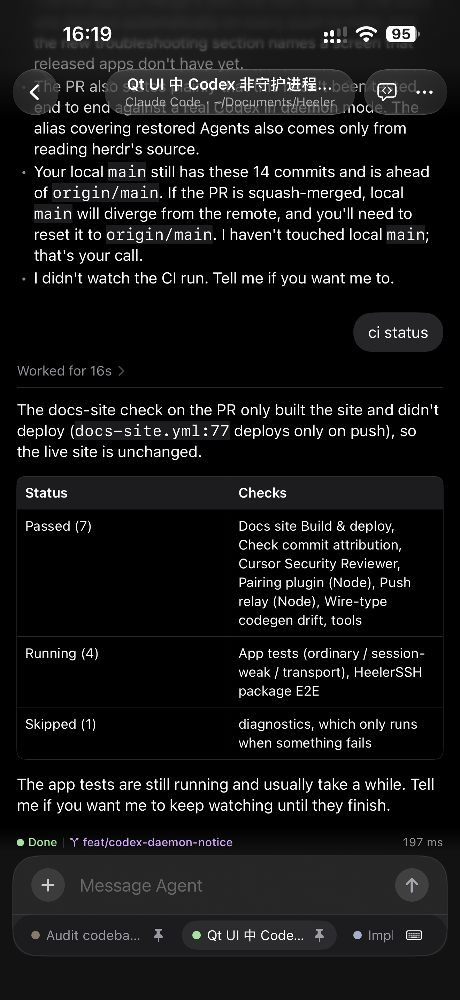
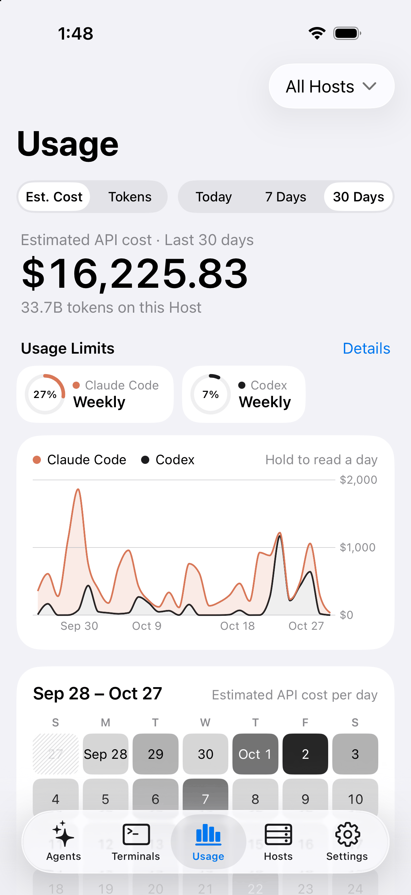
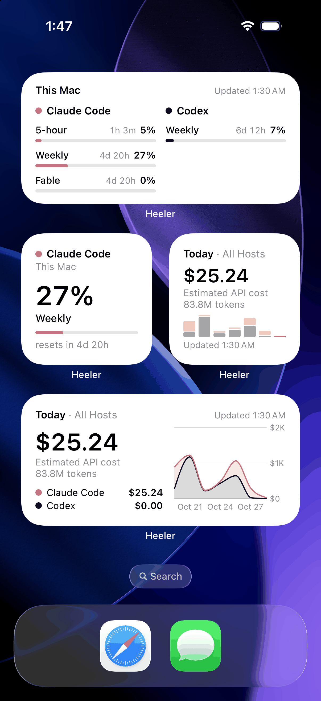
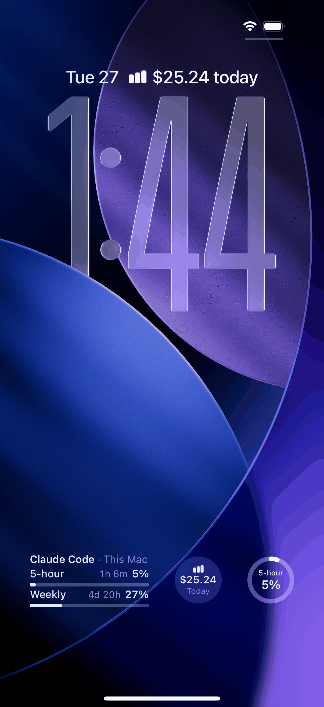

<div align="center">


# Heeler

<a href="https://apps.apple.com/us/app/heeler-for-herdr/id6797263135"></a>
<a href="https://testflight.apple.com/join/aXSxRn4r"></a>

**[herdr](https://herdr.dev) 的原生 iOS 伴侣应用 —— herdr 是一个 agent 优先的终端运行时。**

[](https://github.com/ZingerLittleBee/Heeler/stargazers)
[](https://github.com/ZingerLittleBee/Heeler/actions/workflows/ci.yml)
[](LICENSE)
[](https://www.swift.org)
[](https://developer.apple.com/ios/)
[](https://apps.apple.com/us/app/heeler-for-herdr/id6797263135)

<a href="https://trendshift.io/repositories/151670?utm_source=repository-badge&amp;utm_medium=badge&amp;utm_campaign=badge-repository-151670" target="_blank" rel="noopener noreferrer"></a>

[English](./README.md) | 简体中文

</div>

---

Heeler 是一个 **agent 控制台**：把所有机器上正在运行的 coding agent 汇成一个原生仪表盘，按「谁需要你」排序。打开一个 Agent 即可阅读并操控它的实时终端，在原生 Composer 里用完整的 iOS 键盘起草，一次 Send 投递完整消息 —— 全程只走普通 SSH。

## 截图

| Agent Console | 实时终端 | Chat |
| --- | --- | --- |
|  |  |  |

| Keyboard | Changes | Terminals |
| --- | --- | --- |
|  |  |  |

| Skills | Hosts | 实时活动 |
| --- | --- | --- |
|  |  |  |

| Usage | 小组件 | 锁屏小组件 |
| --- | --- | --- |
|  |  |  |

<a href="docs/ipad-screenshots.md"></a>

[查看 iPad 截图](docs/ipad-screenshots.md)

## 功能

- **Console** —— 所有机器上的 Agent 汇成一个按状态排序的列表（Blocked
  排最前），可按 Host 过滤，实时更新。
- **Attach** —— libghostty 渲染的 Agent 真实终端：原生历史回看、也能驱动全屏
  TUI 的惯性触摸滚动、长按选择、接管失效的终端占用者，并静默收集网页链接
  供稍后打开。
- **Chat** —— 以原生消息而不是终端画面阅读 Agent 的对话，在 Composer 里
  回复，并用按钮回答 Blocked 的 Agent；支持 Claude Code、Codex、Pi、
  Oh My Pi、Grok Build 和 OpenCode（[了解更多](https://docs.heeler.bybee.dev/zh/chat)）。
- **Composer** —— 在本地用完整的 iOS 键盘起草（自动纠错、输入法、听写），
  一次 Send 投递；工具键盘另有 Agent 控制键、Agent Skills、可复用的
  Snippets 和终端外观。
- **Terminal** —— 在 Agent 的目录打开普通 shell，带 Text / Keys 两种模式，
  每个工作区复用同一个 tab。
- **附件** —— 把照片或最大 64 MiB 的文件经 SFTP 暂存到 Host，并把路径
  插入草稿。
- **扫码配对** —— 扫描 Pairing Code 即可添加机器；密钥在设备上生成，私钥
  不离开 Keychain，配对码同时固定 host key 指纹。
- **通知 + 实时活动** —— Agent 进入 Blocked 或 Done 时的端到端加密推送，
  以及锁屏 / 灵动岛上实时跟踪 Agent 的横幅；中继永远读不到内容
  （[PRIVACY.md](PRIVACY.md)）。
- **Usage** —— Claude Code 与 Codex 的 Usage Limits 及重置时间，以及最多
  30 天的 Token Usage 和估算 API 费用，可汇总所有 Host 或只看一台；主屏和
  锁屏小组件随时可见（[了解更多](https://docs.heeler.bybee.dev/zh/usage)）。
- **Worktrees** —— 让 Agent 从工作区仓库的干净检出上启动。
- **外观** —— 跟随系统 / 浅色 / 深色；30 个终端主题，浅色深色各有独立
  槽位；内置 JetBrains Mono 与 IBM Plex Mono；双指缩放字号。
- **跳板机** —— 经 SSH 跳板访问不可直连的机器，两跳各自校验密钥。

## 连接原理

在 macOS 和 Linux Host 上，Heeler 通过 SSH 使用 herdr 的 JSON API：每个请求经 direct-streamlocal
通道直连 `herdr.sock`，一条长连接承载事件流，交互终端则在 SSH PTY 上运行
`herdr agent attach --takeover`。前提只有 SSH 访问和一个运行中的
herdr —— 不改服务器、不装额外软件包。SSH 服务器需允许 stream-local 转发
（OpenSSH 默认开启）；若被关闭，引导流程会明确指出。

Windows 原生 Host（herdr >= 0.9.3）通过 SSH 连接，需手动添加。

如需通过 Tailscale、ZeroTier 或 EasyTier 访问机器，请参阅 [Overlay Network 设置教程](docs/guides/zh/overlay-networks.md)。教程涵盖 macOS 安装、Mac 上不装 VPN 的 Tailscale 方案、Heeler 配置和连接验证。Heeler 在应用内加入这些网络，无需配置 iOS 系统 VPN；需要带有 **Settings > Overlay Networks** 的 Heeler 版本。

[查看 Heeler 配置截图](docs/guides/zh/overlay-networks.md#heeler-配置界面截图)，包括 Tailscale、ZeroTier 以及 EasyTier 两种模式（Network 与 Config Server）的设置界面。

不可直连的机器可以放在 SSH 跳板机之后：

- [逐步搭建远程访问](docs/guides/zh/vps-jump-host-setup.md)
- [架构、安全边界与 VPS 迁移手册](docs/guides/zh/vps-jump-host.md)

一个 Host 可以有多条路由，例如在家用局域网地址，在外走 Overlay Network 或跳板机：[多路由使用教程](docs/guides/zh/host-routes.md)。

## 安装

从 [App Store](https://apps.apple.com/us/app/heeler-for-herdr/id6797263135) 或
[TestFlight](https://testflight.apple.com/join/aXSxRn4r) 安装 Heeler。

- **macOS / Linux：** 安装 [herdr](https://herdr.dev/docs/install/)，启用 SSH，再按下方步骤配对。
- **Windows 原生环境：** 参见 [Windows 设置指南](docs/guides/zh/windows-setup.md)。

## 添加机器

在运行 herdr 的 macOS 或 Linux 机器上（Node >= 20、herdr >= 0.7.5、已启用 OpenSSH 服务器
—— macOS 上是 **系统设置 > 通用 > 共享 > 远程登录**）：

```bash
herdr plugin install ZingerLittleBee/Heeler --ref plugin --yes
herdr plugin action invoke heeler.pair
```

用应用扫描弹出的 Pairing Code 二维码，机器即被添加为 Host —— 地址、
host key 指纹和 SSH 密钥注册全部由配对码承载。在应用里为该 Host 启用通知
后，同一个[插件](plugin/README.md)负责投递加密通知。完整步骤、弹窗按键和排错
方法见[扫码配对指南](https://docs.heeler.bybee.dev/zh/pairing)。

## 从其他应用打开 Agent

其他应用可以通过如下链接在 Heeler 中直接打开某个 Agent：

```text
heeler://agent?host=my-mac&session=work&pane=w1%3Ap1
```

- `host` 指定该会话下已保存的 Host：优先匹配地址，若该会话下没有匹配该地址的 Host，则匹配 Host 名称（忽略大小写）。
- `session` 是 herdr 会话名称。留空或传入 `default` 表示默认会话。
- `pane` 是 herdr 的窗格 ID（pane id）。留空则直接打开 Console。

请对每个参数值进行百分号编码，且空格需编码为 `%20`：`+` 会被保留为加号本身，因此表单编码（如 JavaScript 的 `URLSearchParams`）无法匹配像 `Build Box` 这样带空格的名称。如果该会话下没有匹配的已保存 Host，或匹配到多个 Host，链接会打开 Console。

## 技术栈

- SwiftUI，iOS 18+，iPhone 与 iPad。0.1.8 恢复 iPad 支持，含 Magic Keyboard 快捷键、多窗口和拖放。
- 仓库内 `Packages/HeelerSSH`（libssh2 + OpenSSL）负责 SSH
- [libghostty-spm](https://github.com/lakr233/libghostty-spm) 负责终端仿真与 Metal 渲染

选型依据见 `docs/adr/`，其中传输层方案经过多轮验证后才最终确定。

## 参与贡献

欢迎 Issue 和 PR：仓库结构、构建与测试、提交约定见 [CONTRIBUTING.md](CONTRIBUTING.md)。

## 状态

已在 [App Store](https://apps.apple.com/us/app/heeler-for-herdr/id6797263135) 上发布；部分国家和地区尚未上架，可以继续使用 [TestFlight](https://testflight.apple.com/join/aXSxRn4r)。以个人日常使用打磨为先，仍有粗糙之处，迭代较快。与 herdr 项目无隶属关系。
