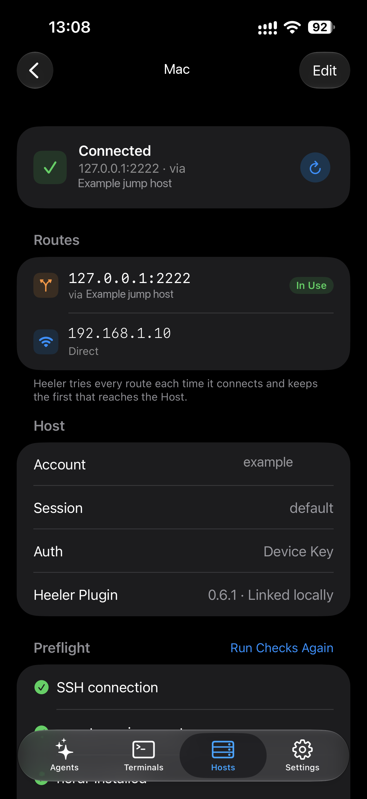

# Reach a Host on several routes

A Host can have more than one route: its LAN address for when you are at home, and an overlay network or a Jump Host for everywhere else. Heeler tries every route each time it connects and uses the first one that reaches the Host, so you never switch anything by hand.

## Add a route

1. Go to **Hosts**, open the Host, and tap **Edit**.
2. Under **Routes**, tap **Add Route**.
3. Under **Network**, choose how this route travels:
   - **Direct** for an address this iPhone or iPad can reach on its own network, such as the Mac's LAN address or a public address.
   - An overlay network from **Settings > Overlay Networks** for Tailscale, ZeroTier, or EasyTier. For Tailscale and EasyTier, tap **Choose from Tailnet…** or **Choose from Network…** and pick the Mac to fill in its address; for ZeroTier, type the Mac's address from ZeroTier Central. See the [Overlay Network guides](overlay-networks.md) to set one up.
4. Enter the **Address** and **Port** (22 unless you changed the Mac's SSH port).
5. To go through a Jump Host, fill in the **Jump Host** fields. Otherwise leave them blank. See [remote access through a Jump Host](vps-jump-host-setup.md).
6. Tap **Save** at the top right, then **Save** in Edit Host.

**Add Host** starts with no route; tap **Add Route** to enter the first address the same way. [Scanning a Pairing Code](pairing.md) adds every address the code offers as a route of its own.

## How Heeler picks a route

- Each time it connects, Heeler races the Host's routes with staggered starts and keeps the first that reaches it.
- **Direct** routes without a Jump Host start first. Overlay network and Jump Host routes start a moment later, or right away once every direct route has failed. At home the LAN address can win before an overlay network ever starts.
- The order of the list does not decide which route wins. The first route is only the address shown for the Host in the Hosts list.
- A connection keeps its route until it ends. If you move from Wi-Fi to cellular, the next connection picks again.

## See which route is in use

Open the Host from **Hosts**. The card at the top shows the connection:

- **Connected** names the route it used, and that route is marked **In Use** under **Routes**. Tap ↻ to reconnect.
- While Heeler is connecting, tap ■ to stop trying. The Host stays paused until you tap **Reconnect**.
- **Can't Connect** means no route reached the Host. Each route is marked **Failed** with its own reason, such as a timeout or an overlay network that isn't connected.

Here the Jump Host route is **In Use**; the **Direct** route is not selected. This illustrates route selection, not an overlay connection test. Names and addresses have been anonymized. Tap the image to enlarge it.

## Change, reorder, or remove routes

In **Edit**, tap a route to change it, or tap **Delete Route** on its page. With more than one route, tap **Edit** beside **Routes** to drag routes into a new order or delete them. A Host always keeps at least one route.

## Every route must reach the same machine

Heeler confirms a Host's key once, and every route has to reach the machine with that key. If another machine answers one of the addresses, for example the same LAN address on someone else's Wi-Fi, that route fails instead of connecting. Adding a route to the same Mac does not ask you to confirm the key again.

## If a route always fails

- Read its reason under **Routes** on the Host's page.
- For an overlay network route, check that the network shows as connected in **Settings > Overlay Networks** and that the Mac is online in it.
- For a Jump Host route, check that you can reach the Jump Host and that it accepts the same Device Key, RSA Key, or password as the Host. See [the Jump Host guide](vps-jump-host-setup.md).
- For a LAN address, it only answers on that network. Away from home it fails, and another route connects instead.
