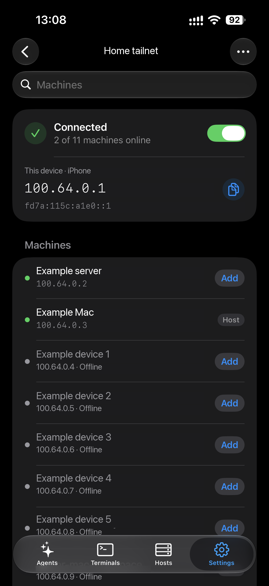

<!-- Translated from docs/guides/tailscale.md at 93baae40 -->

# 通过 Tailscale 连接 Heeler

Heeler 会直接加入你的 tailnet，因此手机上无需安装 Tailscale 应用或配置系统 VPN。

## 开始之前

- 你需要使用包含 **Settings > Overlay Networks** 的 Heeler 版本。
- 你需要一个可以添加设备的 Tailscale 账号。
- 如果不想在 Mac 上安装系统 VPN 或网络扩展，请按[不在 Mac 上配置 VPN 运行 Tailscale（进阶）](#不在-mac-上配置-vpn-运行-tailscale进阶)操作，代替第 2 步。

## 1. 准备 Mac

先完成[准备 Host](overlay-networks.md#准备-host)。无需开启 Tailscale SSH。

## 2. 在 Mac 上安装 Tailscale

1. 从 [Install Tailscale on macOS](https://tailscale.com/docs/install/mac) 下载 **Standalone** 版本应用并打开。
2. 按提示允许添加 VPN 配置。在 macOS 15 及更高版本上，还需前往 **System Settings > General > Login Items & Extensions > Network Extensions** 开启 **Tailscale Network Extension**。旧版 macOS 请参考 [Tailscale 系统扩展说明](https://tailscale.com/docs/concepts/macos-sysext)。
3. 从菜单栏图标登录账号；如果 tailnet 开启了设备审批，请批准这台 Mac。
4. 在管理控制台的 [Machines](https://login.tailscale.com/admin/machines) 页面记下 Mac 的 Tailscale IP。

## 3. 从 Heeler 加入同一个 tailnet

1. 前往 **Settings > Overlay Networks > Add Network**，选择 **Tailscale**。
2. 填写表单：

   | 字段 | 值 |
   | --- | --- |
   | Name | 任意名称，例如 `Home tailnet` |
   | Device name | Heeler 在 tailnet 中显示的名称（默认 `heeler`） |
   | Advanced | 留空即可使用浏览器登录 |

   <a href="../images/overlay-networks/tailscale-form.png"></a>

3. 轻点 **Continue to Sign In**，使用与 Mac 相同的账号登录。
4. 返回 Heeler，应用会自动建立连接，网络状态显示为 **Connected**。

如果看到 **Waiting for approval**，请轻点 **Open Admin Console** 并批准 Heeler。如果提前退出了浏览器，可轻点 **Sign In with Browser** 重新登录。

如果想跳过浏览器登录，可以在 **Advanced** 下输入 Auth Key，或在网络详情页轻点 **Use an Auth Key Instead**。如果使用 Headscale，请将其 HTTPS 地址填入 **Coordination server**。

如果你修改过 tailnet 的访问控制规则（ACL / Grants），请确保允许 Heeler 访问 Mac 的 22 端口。

## 4. 将 Mac 添加为 Host

按以下配置添加 Host（详细说明见[从 Heeler 连接](overlay-networks.md#从-heeler-连接)）：

1. 在网络详情页直接轻点 Mac 旁的 **Add** 自动填入路由；或者前往 **Hosts > Add Host**，在 **Routes** 下轻点 **Add Route**，将 **Network** 设为刚才创建的 Tailscale 网络，然后轻点 **Choose from Tailnet…**（保持 **Fill In** 为 **IP Address**）并选择你的 Mac。
2. 路由端口保持为 `22`，**Jump Host** 留空；若通过 **Add Route** 进入，轻点保存该路由。
3. 在 **Add Host** 中填入你的 Mac 用户名（`User`）和所选登录方式。
4. 保存后，核对指纹与 Mac 一致再轻点信任。

<a href="../images/overlay-networks/tailscale-machines.png"></a>

请使用 **Machines** 列表中 Mac 的地址，不要使用 **This device** 下的手机地址。图中 Mac 已添加为 Host，因此按钮显示 **Host**；另一台尚未添加的机器仍显示 **Add**。名称与地址已匿名化，轻点图片可放大查看。

## 5. 验证连接是否正常

完成[验证连接](overlay-networks.md#验证连接)，包括在蜂窝网络下测试。使用期间请保持 Mac 处于唤醒状态并已登录 Tailscale。

## 不在 Mac 上配置 VPN 运行 Tailscale（进阶）

你可以不使用第 2 步中的 Tailscale 应用，而是在 Mac 的终端中运行 Tailscale，这样不会在 Mac 上添加系统 VPN 或网络扩展。Heeler 仍会加入同一个 tailnet，并通过 Mac 的常规 SSH 登录。你需要准备 [Homebrew](https://brew.sh/)。

### 1. 检查 Mac 本机的 SSH

完成[准备 Mac](#1-准备-mac)后，确认 Mac 本机的 SSH 服务正常响应：

```sh
nc -vz 127.0.0.1 22
```

连接应当成功。如果被拒绝，请检查是否已开启 **Remote Login**（远程登录）。

### 2. 用 Homebrew 安装 Tailscale

```sh
brew install --formula tailscale
```

请不要使用 `brew services` 启动它，而是按下一步的方式运行。

### 3. 启动 Tailscale

打开一个终端窗口（记为**终端 A**）并运行：

```sh
TS_BIN="$(brew --prefix tailscale)/bin"
TS_STATE_DIR="$HOME/.local/share/heeler-tailscale"
umask 077
mkdir -p "$TS_STATE_DIR"
chmod 700 "$TS_STATE_DIR"
"$TS_BIN/tailscaled" \
  --tun=userspace-networking \
  --statedir="$TS_STATE_DIR" \
  --socket="$TS_STATE_DIR/tailscaled.socket"
```

请保持**终端 A** 打开，直到完成登录和连接检查。之后如需关闭终端仍保持运行，可配置[自动启动](#5-登录后自动启动可选)。

### 4. 登录 Mac 节点

打开第二个终端窗口（记为**终端 B**）并运行：

```sh
TS_BIN="$(brew --prefix tailscale)/bin"
TS_STATE_DIR="$HOME/.local/share/heeler-tailscale"
"$TS_BIN/tailscale" --socket="$TS_STATE_DIR/tailscaled.socket" up \
  --hostname=heeler-mac-userspace
"$TS_BIN/tailscale" --socket="$TS_STATE_DIR/tailscaled.socket" status
"$TS_BIN/tailscale" --socket="$TS_STATE_DIR/tailscaled.socket" ip -4
```

1. 打开 `up` 命令输出的登录链接，登录 Heeler 将要加入的同一个 tailnet。
2. 如果你的 tailnet 开启了设备审批，请在管理控制台中批准这台 Mac。
3. 记下 `ip -4` 输出的 IPv4 地址。

> [!IMPORTANT]
> 在此模式下，tailnet 中任何获准访问这台 Mac 的设备，都可以访问 Mac 本机监听的所有服务（而不仅是 SSH）。请在 tailnet 的[访问控制规则](https://tailscale.com/docs/features/access-control/grants)中，仅允许 Heeler 访问这台 Mac 的 `tcp:22` 端口。

然后继续完成[从 Heeler 加入同一个 tailnet](#3-从-heeler-加入同一个-tailnet)到[验证连接是否正常](#5-验证连接是否正常)的步骤。在[将 Mac 添加为 Host](#4-将-mac-添加为-host)中，通过 **Choose from Tailnet…** 选择 `heeler-mac-userspace`，或直接输入刚才记下的 IPv4 地址。使用 Heeler 期间请保持 Mac 唤醒且**终端 A** 打开。

### 5. 登录后自动启动（可选）

使用用户级 LaunchAgent，让同一个用户态进程在每次登录 Mac 后自动启动，并在进程退出时重新拉起。无需 `sudo`，也不会添加系统 VPN。它沿用上面的状态目录，保留同一个 Tailscale 身份和 IP；除非授权过期，否则无需重新登录。

这是**用户登录后启动**，不是重启后、登录前启动。它无法在 FileVault 解锁界面运行，也不能让休眠中的 Mac 保持可连接。若需要在用户登录前提供无人值守访问，需由管理员另行配置系统级 LaunchDaemon，本教程不涵盖该方式。

先在**终端 A** 中按 **Control-C**。不要同时运行手动进程和 LaunchAgent。

在**终端 B** 中查询绝对路径，并创建 LaunchAgents 目录：

```sh
brew --prefix tailscale
printf '%s\n' "$HOME"
mkdir -p "$HOME/Library/LaunchAgents"
```

创建 `~/Library/LaunchAgents/dev.heeler.tailscaled.plist`，填入以下内容。将所有 `TAILSCALE_PREFIX` 替换为第一条命令的输出（Apple Silicon 通常为 `/opt/homebrew/opt/tailscale`，Intel 通常为 `/usr/local/opt/tailscale`），将所有 `MAC_HOME` 替换为第二条命令的输出。plist 内必须使用绝对路径，不能使用 `~`、`$HOME` 或 shell 命令。

```xml
<?xml version="1.0" encoding="UTF-8"?>
<!DOCTYPE plist PUBLIC "-//Apple//DTD PLIST 1.0//EN" "http://www.apple.com/DTDs/PropertyList-1.0.dtd">
<plist version="1.0">
<dict>
    <key>Label</key>
    <string>dev.heeler.tailscaled</string>
    <key>ProgramArguments</key>
    <array>
        <string>TAILSCALE_PREFIX/bin/tailscaled</string>
        <string>--tun=userspace-networking</string>
        <string>--statedir=MAC_HOME/.local/share/heeler-tailscale</string>
        <string>--socket=MAC_HOME/.local/share/heeler-tailscale/tailscaled.socket</string>
    </array>
    <key>RunAtLoad</key>
    <true/>
    <key>KeepAlive</key>
    <true/>
    <key>ThrottleInterval</key>
    <integer>10</integer>
    <key>StandardOutPath</key>
    <string>MAC_HOME/.local/share/heeler-tailscale/tailscaled.log</string>
    <key>StandardErrorPath</key>
    <string>MAC_HOME/.local/share/heeler-tailscale/tailscaled.log</string>
</dict>
</plist>
```

在 Mac 桌面会话的终端中校验并加载：

```sh
PLIST="$HOME/Library/LaunchAgents/dev.heeler.tailscaled.plist"
chmod 600 "$PLIST"
plutil -lint "$PLIST" && launchctl bootstrap "gui/$(id -u)" "$PLIST"
launchctl print "gui/$(id -u)/dev.heeler.tailscaled"
```

如果校验失败，先修正 plist 再加载。服务状态应显示 `state = running`。确认 Tailscale 仍已登录，且 IP 与之前记录的一致：

```sh
"$(brew --prefix tailscale)/bin/tailscale" \
  --socket="$HOME/.local/share/heeler-tailscale/tailscaled.socket" status
"$(brew --prefix tailscale)/bin/tailscale" \
  --socket="$HOME/.local/share/heeler-tailscale/tailscaled.socket" ip -4
```

现在可以关闭两个终端。再次从 Heeler 检查 Host，然后在重启 Mac 并登录后重复检查。若启动失败，检查上面的 `launchctl print` 输出及日志：

```sh
tail -n 50 "$HOME/.local/share/heeler-tailscale/tailscaled.log"
```

如需停止受管进程，应卸载服务，而不是直接结束进程（`KeepAlive` 会将它重新拉起）：

```sh
launchctl bootout "gui/$(id -u)/dev.heeler.tailscaled"
```

用上面的 `bootstrap` 命令可重新加载。如需永久关闭自动启动，卸载服务后再删除 plist：

```sh
rm "$HOME/Library/LaunchAgents/dev.heeler.tailscaled.plist"
```

### 停止或移除 Mac 节点

对于手动启动的进程，在**终端 A** 中按 **Control-C** 即可停止 tailnet 访问。需要恢复时，重新执行[启动 Tailscale](#3-启动-tailscale)。重启 Mac 或注销账户后它也会停止。如果已配置自动启动，请改用上面的 `bootout`；除非删除 plist，否则 LaunchAgent 会在下次登录时再次启动。

如需将这台 Mac 从 tailnet 中移除，请在进程仍在运行时执行（手动启动或由 LaunchAgent 托管均可）：

```sh
"$(brew --prefix tailscale)/bin/tailscale" \
  --socket="$HOME/.local/share/heeler-tailscale/tailscaled.socket" logout
```

然后停止进程：如果使用 LaunchAgent，按上文卸载服务并删除 plist；如果是手动启动，在**终端 A** 中按 **Control-C**。完成后再删除保存的本地状态：

```sh
rm -rf "$HOME/.local/share/heeler-tailscale"
```

如果管理控制台中仍显示该 Mac 节点，请在控制台中将其移除。

## 故障排查

| 问题 | 解决方法 |
| --- | --- |
| **Choose from Tailnet…** 里找不到 Mac | 确认两端登录的是同一个 tailnet 且均已获批，或直接在 **Address** 中手动输入 Mac 的 Tailscale IP。 |
| SSH 连接超时 | 确认 Mac 未休眠且在线，并检查访问规则是否允许访问 22 端口。 |
| SSH 登录失败 | 请使用 Mac 系统的密钥或账户密码，不要填 Tailscale 账号密码。 |
| SSH 正常但 herdr 检查失败 | 按[准备 Host](overlay-networks.md#准备-host)重新检查 herdr 状态。 |
| 显示 **Not signed in** 或 **Signed out** | 在网络列表行上轻点 **Sign In**，或点进该网络后轻点 **Sign In with Browser**。 |
| 免 VPN 模式：终端 B 无法连接 Tailscale，或显示了另一台机器 | 确保终端 A 仍在运行，或检查 LaunchAgent，并使用教程中指定的 socket 路径。 |
| 免 VPN 模式：Mac 在线但 SSH 超时 | 确认在 Mac 上运行 `nc -vz 127.0.0.1 22` 成功，且访问规则允许 Heeler 访问该 Mac 的 `tcp:22`。 |
| 免 VPN 模式：Mac 上的其他应用无法访问 tailnet 设备 | 这是预期行为。在此模式下，Mac 本机应用不走 tailnet，但 tailnet 设备仍可连入 Mac。 |
| 免 VPN 模式：重启后无法连接 | 若已配置[自动启动](#5-登录后自动启动可选)，先登录 Mac，再检查服务和日志。否则在终端 A 中重新运行[启动 Tailscale](#3-启动-tailscale)。 |

## 退出登录或移除 Heeler

在网络详情页右上角 **…** 菜单中轻点 **Sign Out**，只会退出 Heeler 本身，不会影响 Mac。退出后关联的 Host 会保持断开，直到你再次登录。

如需彻底撤销 Heeler 的访问权限，请在 Tailscale 管理控制台的 **Machines** 页面删除该设备，并在 **Keys** 页面吊销使用过的 Auth Key。

核对依据为 Tailscale 官方文档（2026-10-09）。免 VPN 模式的命令已对照 Tailscale 1.104.1 核对（2026 年 10 月）。

维护者：参见[指南维护记录](../../agents/overlay-network-guides.md)。
